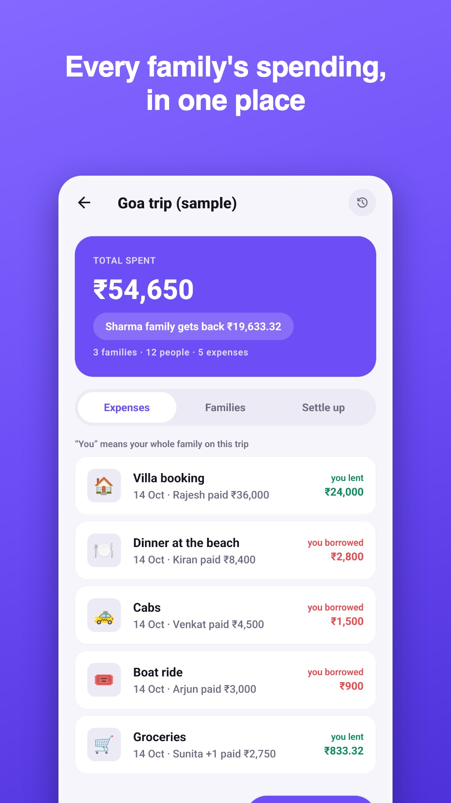
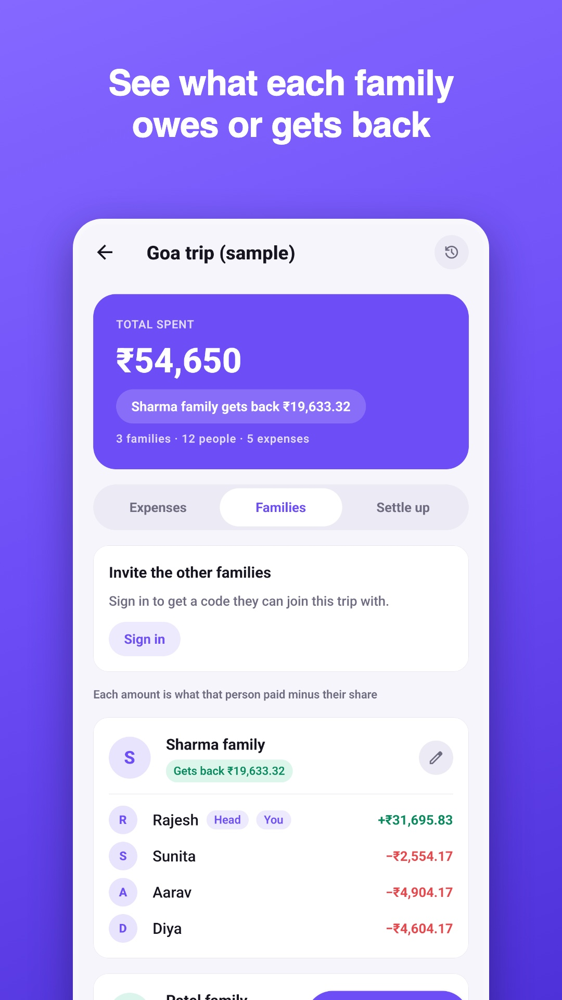
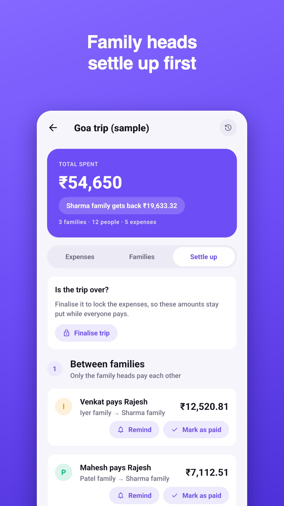
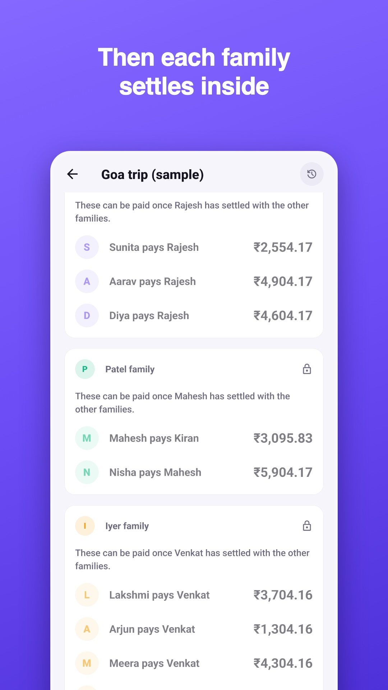

<p align="center">
  
</p>

<h1 align="center">FamSplit</h1>

<p align="center">
  Split trip expenses with family or friends, and settle up in the fewest payments.
</p>

<p align="center">
  
  
  
  
</p>

<table align="center">
  <tr>
    <td></td>
    <td></td>
    <td></td>
    <td></td>
  </tr>
</table>

## Why FamSplit

When several families travel together, most expense apps treat everyone as one big group, which leads to lots of small payments between people who may not know each other well. FamSplit settles the way families actually do it:

1. **Between families:** only the family heads pay each other, for example *Venkat pays Rajesh*.
2. **Inside each family:** everyone then squares up with their own head, for example *Sunita pays Rajesh*.

For groups without families, a **Friends** trip has everyone settle with everyone, in as few payments as possible. The trip type is chosen when the trip is created and can't be changed later.

## Features

**Trips and expenses**
- Family and Friends trips, including people who don't use the app, such as children and grandparents
- Split per person, per family, by shares or by exact amounts
- Expenses paid by several people
- Expense categories, and a split preview before saving
- A log of who added, changed or deleted what

**Settling up**
- The fewest payments needed, with progress tracked for each one
- Pay with UPI: opens the person's own UPI app, or copy the UPI ID and amount
- Reminder notifications for whoever owes
- Finalise a trip to lock its expenses while everyone pays
- A PDF summary of the whole trip

**Sharing**
- Google sign-in, with invite codes to join a trip
- Live updates and push notifications when others make changes
- Works offline and syncs when back online
- Works without an account too, with trips kept on that phone only

**Personal tracking**
- My spending: monthly spending by category, across personal expenses and trip shares
- Bank payment alerts (Android, optional): spots payments in notifications and offers to add them
- Paste a bank SMS to add a payment by hand

**Also**
- English, Hindi and Marathi
- Light and dark themes
- No ads. FamSplit never handles money; UPI payments happen in the person's own UPI app.

## Project status

| Platform | Status |
|---|---|
| Android | In closed testing on Google Play |
| iPhone | Not available |
| Web | Not supported yet. The current web build doesn't run. |

## Tech stack

- [Expo](https://expo.dev) SDK 57 and React Native, with TypeScript
- [Expo Router](https://docs.expo.dev/router/introduction/) for navigation
- [Supabase](https://supabase.com) for Postgres, Google sign-in, realtime updates and Edge Functions
- Firebase Cloud Messaging for push notifications, and Firebase Hosting for the privacy and account deletion pages
- A local Expo module written in Kotlin for bank payment alerts
- Jest for tests

Each phone keeps its own copy of the data, so screens open instantly and expenses can be added offline. Signed-in changes sync through Supabase. Amounts are handled in paise, so they stay exact.

## Getting started

### Requirements

- Node.js (current LTS)
- Android Studio with an emulator or a connected Android phone
- JDK 17

The app includes its own native code, so it needs a development build and won't fully work in Expo Go.

### Run the app

```bash
npm install
cp .env.example .env.local
npm run android
```

Without Supabase values in `.env.local`, the app still runs, but trips stay on that phone and there's no sign-in or sharing.

### Set up Supabase

Needed for sign-in, sharing and sync.

1. Create a Supabase project, then put its URL and publishable key in `.env.local`.
2. Run [`supabase/schema.sql`](supabase/schema.sql) once in the SQL editor.
3. Turn on the Google provider under Authentication, and add `famsplit://auth-callback` to the allowed redirect URLs.
4. Deploy the Edge Functions:

   ```bash
   npx supabase link --project-ref YOUR_PROJECT_REF
   npx supabase functions deploy notify --no-verify-jwt
   npx supabase functions deploy delete-account --no-verify-jwt
   ```

5. For push notifications:
   - Replace `google-services.json` with the file from your own Firebase project.
   - Set the `FIREBASE_SERVICE_ACCOUNT` secret to a Firebase service account's JSON key, using `npx supabase secrets set`.
   - Tell the database where the function is, in the SQL editor:

     ```sql
     insert into public.app_settings values ('notify_url', 'https://YOUR-PROJECT.supabase.co/functions/v1/notify');
     ```

**Upgrading an existing project:** run only the `supabase/update-N.sql` files it hasn't had yet, in order. `schema.sql` is for new projects.

## Development

```bash
npm start              # start the dev server
npm test               # run the unit tests
npm run test:native    # run the Kotlin tests for bank alerts
npm run lint           # lint
npx tsc --noEmit       # typecheck
```

### Project layout

```
src/
  app/             Screens and routes (Expo Router)
  components/      Shared UI, with trip screens in components/trip
  domain/          Money, balances, settlement and bank alert parsing
  store/           Data kept on the phone, and calculations built on it
  sync/            Supabase client and sync
  notifications/   Push notifications and bank alerts
  i18n/            English, Hindi and Marathi text
  export/          PDF trip summary
modules/
  bank-alerts/     Android module that reads payment notifications
supabase/
  schema.sql       Full database for a new project
  update-N.sql     Changes for an existing project
  functions/       The notify and delete-account Edge Functions
web/               Landing, privacy policy and account deletion pages
store-listing/     Google Play text and images
scripts/           Release build script
```

`android/` is generated, so don't edit it by hand. Change `app.json` or a config plugin instead.

## Releasing

### Android

1. Raise `expo.android.versionCode` in `app.json`. Every upload to Google Play needs a higher number. Change `expo.version` too if it's a new version.
2. Build the signed bundle:

   ```bash
   npm run build:release
   ```

3. Upload `dist/famsplit-<version>-<versionCode>.aab` to Google Play.

The upload key and its passwords are kept outside this repository and must never be committed. The comment at the top of [`scripts/build-release.sh`](scripts/build-release.sh) explains where they go.

### Web pages

```bash
npx firebase-tools deploy --only hosting
```

## Privacy

- [Privacy policy](https://famsplit-75fca.web.app/privacy)
- [Delete your account](https://famsplit-75fca.web.app/delete-account)

Bank payment alerts are optional and stay on the phone.
